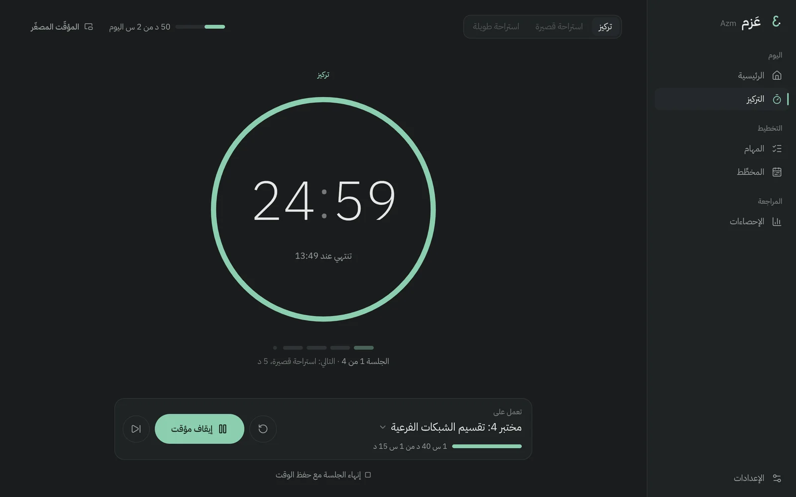
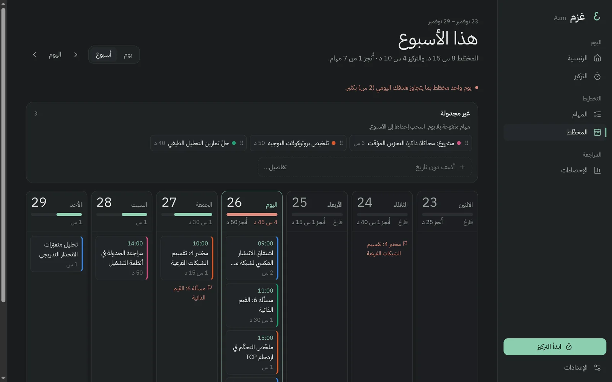
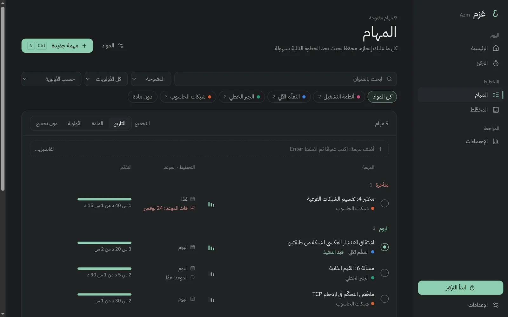
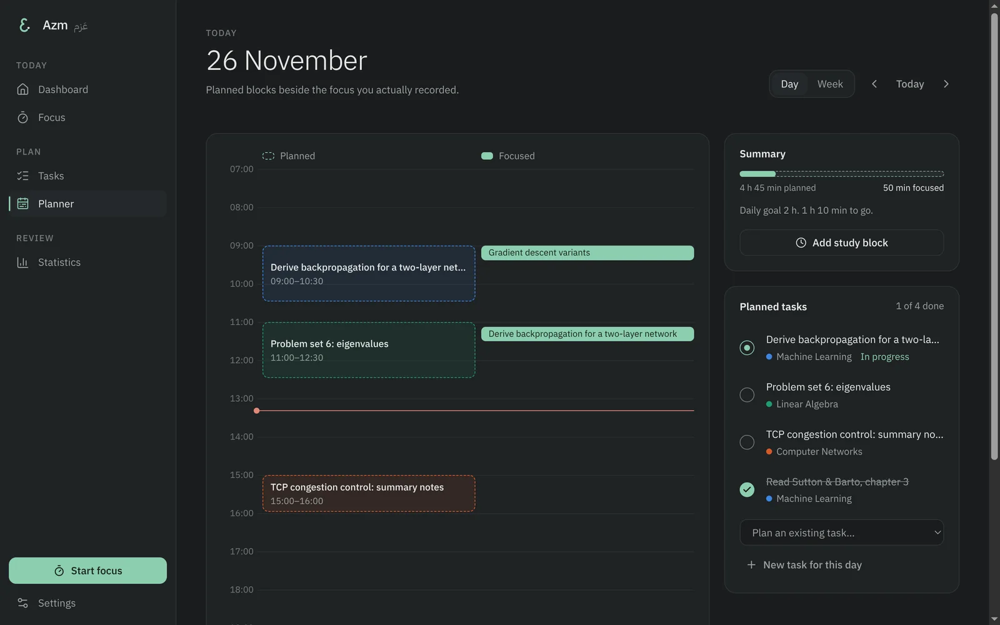
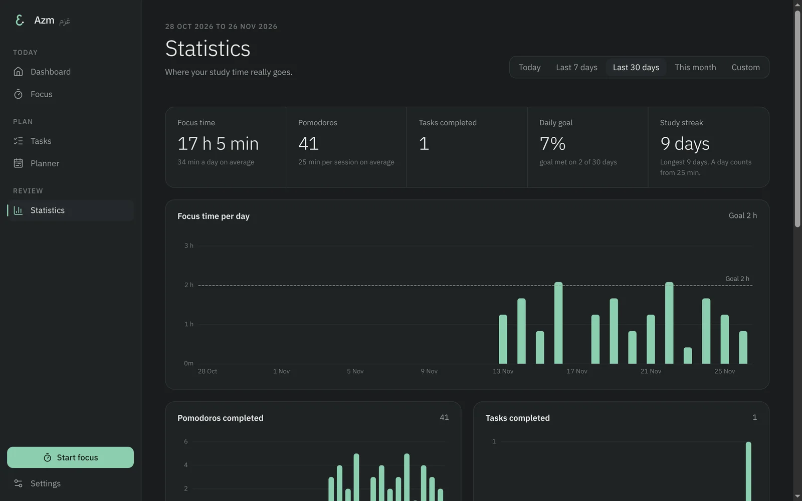

<div align="center">


# عَزم · Azm

**«بِعزمٍ، خطوةً بعد خطوة»**<br />
*Steady focus. Meaningful progress.*

A calm, offline focus timer, task manager and study planner for the desktop.<br />
Designed Arabic first, with a complete English interface.

[](https://github.com/LokmanBrahmia/FocusFlow/releases/latest)


[**Website**](https://focusflow-lokman.netlify.app) ·
[**Download**](https://github.com/LokmanBrahmia/FocusFlow/releases/latest) ·
[**Releasing & deploying**](DISTRIBUTION.md)

<br />



</div>

---

## Contents

- [Overview](#overview)
- [Features](#features)
- [Screenshots](#screenshots)
- [Download and install](#download-and-install)
- [Updates](#updates)
- [Your data and privacy](#your-data-and-privacy)
- [Keyboard shortcuts](#keyboard-shortcuts)
- [Development](#development)
- [Architecture](#architecture)
- [Design](#design)
- [Languages](#languages)
- [Releasing](#releasing)
- [Known limitations](#known-limitations)
- [License](#license)

## Overview

Azm (عَزم, *resolve*) helps students plan what to study, focus on one task at a time, and see
where their time actually goes. It runs entirely on your computer: no account, no analytics,
and no internet connection required. The only network request is an optional check for new
versions on GitHub Releases.

Azm was previously called **FocusFlow**. Existing installations upgrade in place and keep all
their data (see [Compatibility with FocusFlow](#compatibility-with-focusflow)).

Built with Electron, Vue 3, TypeScript, Tailwind CSS and SQLite.

## Features

| | |
| --- | --- |
| **Focus timer** | Focus sessions, short and long breaks, auto-start, sounds, notifications and a floating always-on-top mini timer. Time is calculated from timestamps in the main process, so it stays exact when the window is minimised or the computer sleeps, and survives restarts. |
| **Dashboard** | The next step and the button that starts it, today's progress against your goal, today's plan with quick add, the day's schedule, upcoming deadlines and the week at a glance. |
| **Tasks and subjects** | Priorities, statuses, estimates, deadlines and planned days. Group by date, subject or priority; add a task by typing its title. Progress is the focus you actually spent against your estimate. |
| **Planner** | A week view with an unscheduled tray you drag onto days, a per-day load against your daily goal, and a day timeline of planned study blocks beside recorded focus. |
| **Statistics** | Focus per day against your goal, Pomodoros, tasks, streaks, subjects, weekday and time-of-day patterns, and focus quality, for any date range. |
| **Focus quality** | An optional 1–5 rating and note after each completed focus session. |
| **Your data** | JSON export and import, database backup and restore, with an automatic safety copy before anything is replaced. |
| **Desktop integration** | Dark, light or system theme, close to tray, launch at login, remembered window size and keyboard shortcuts. |

## Screenshots

Real screenshots of Azm with sample data. Arabic is the default language; English is one click away in Settings.

<table>
  <tr>
    <td width="50%"><br /><sub>Week planner — Arabic</sub></td>
    <td width="50%"><br /><sub>Tasks — Arabic</sub></td>
  </tr>
  <tr>
    <td width="50%"><br /><sub>Day planner — English</sub></td>
    <td width="50%"><br /><sub>Statistics — English</sub></td>
  </tr>
</table>

## Download and install

Download the latest version from the [website](https://focusflow-lokman.netlify.app) or from
[GitHub Releases](https://github.com/LokmanBrahmia/FocusFlow/releases/latest).

| System | File | Install |
| --- | --- | --- |
| Fedora / RHEL family (x86_64) | `Azm-<version>.x86_64.rpm` | `sudo dnf install ./Azm-<version>.x86_64.rpm` |
| Ubuntu / Debian family (amd64) | `Azm-<version>_amd64.deb` | `sudo apt install ./Azm-<version>_amd64.deb` |
| Windows 10 / 11 (x64) | `Azm-Setup-<version>.exe` | Run the installer (per user, no administrator rights) |

**Requirements.** Linux packages need glibc 2.34 or newer (Fedora 35+, Ubuntu 22.04+,
Debian 12+). The DEB and RPM are tested on clean Ubuntu 22.04 and Fedora 41 installations.
There is no macOS build.

> [!NOTE]
> Packages are not code-signed. Windows SmartScreen shows "unknown publisher" (choose
> *More info* → *Run anyway*), and `dnf` notes that it skipped signature checks.

> [!TIP]
> **Tray icon on GNOME.** Stock GNOME hides tray icons; install the *AppIndicator and
> KStatusNotifierItem Support* extension to see Azm's. Closing to the tray works either way.

## Updates

Azm checks GitHub Releases for a newer **stable** version shortly after it starts and every
six hours (drafts and prereleases are ignored). You can turn this off or check by hand in
**Settings → Updates**. Nothing downloads, installs or restarts unless you click a button.

| Installed from | What happens |
| --- | --- |
| **Windows installer** | Downloads the new installer inside the app, verifies its SHA-512 against the release's `latest.yml`, then installs on *Install and restart* or when you quit. A running focus session is saved and continues after the restart. |
| **Fedora RPM / Ubuntu DEB** | Shows a notice with a link to the new package and the `dnf` or `apt` command to install it. |

<details>
<summary>Why Linux packages aren't updated from inside the app</summary>

electron-updater's DEB and RPM updaters install by running a root shell through `pkexec`,
`gksudo`, `kdesudo` or `beesu`, fall back to plain `sudo` (which can't prompt from a GUI app),
and for RPM use `dnf install --nogpgcheck -y`, which disables signature checks. That is
unreliable across desktops and weakens security, so Azm never runs administrator commands
itself; your package manager installs the update.

All update logic runs in the main process. The interface can only call a few validated
actions, release data is validated before it is shown, and links can only open this
repository's releases page. The repository comes from `repository` in `package.json`.
</details>

## Your data and privacy

- **No account, no analytics, no tracking.** Your study data is never sent anywhere.
- **One local database.** New installations store everything in:

  | Path | Contents |
  | --- | --- |
  | `~/.config/Azm/focusflow.sqlite` (Linux)<br />`%APPDATA%\Azm\focusflow.sqlite` (Windows) | The database (SQLite, WAL mode) |
  | `…/Azm/backups/` | Automatic safety copies taken before an import or restore |
  | `…/Azm/logs/main.log` | Warnings and errors, capped at about 1 MB |

- **Backups are yours.** Export everything as JSON or back up the database from
  **Settings → Your data**. Uninstalling never deletes your data.

### Compatibility with FocusFlow

If `~/.config/FocusFlow/focusflow.sqlite` (or `%APPDATA%\FocusFlow\focusflow.sqlite`) exists
and the Azm folder has no database yet, Azm keeps using the FocusFlow folder. Nothing is moved,
copied or deleted. These identifiers are kept on purpose so Azm installs as an upgrade rather
than beside the old app: the app ID `com.focusflow.app`, the package and executable name
`focusflow`, `focusflow.desktop`, the database file `focusflow.sqlite`, the export format
`focusflow-export`, the `FOCUSFLOW_*` environment variables and the repository name.

## Keyboard shortcuts

| Keys | Action |
| --- | --- |
| <kbd>Space</kbd> | Start or pause the timer |
| <kbd>Ctrl</kbd>/<kbd>⌘</kbd> + <kbd>Shift</kbd> + <kbd>F</kbd> | Start a focus session |
| <kbd>Ctrl</kbd>/<kbd>⌘</kbd> + <kbd>N</kbd> | New task |
| <kbd>Ctrl</kbd>/<kbd>⌘</kbd> + <kbd>1</kbd> … <kbd>4</kbd> | Dashboard, Focus, Tasks, Statistics |
| <kbd>Esc</kbd> | Close a dialog or menu |

Shortcuts pause while you type in a field.

## Development

**Requirements:** Node.js 22 or newer. On Fedora, building the RPM also needs `rpm-build`.

```bash
npm install
npm run dev
```

| Command | Purpose |
| --- | --- |
| `npm run dev` | Start the app with hot reload |
| `npm run typecheck` | Type-check the main, preload and renderer code |
| `npm run lint` | Run ESLint |
| `npm test` | Unit and integration tests (Vitest, 121 tests) |
| `npm run test:e2e` | Build, then drive the real app with Playwright (11 UI tests) |
| `npm run build` | Type-check and build to `out/` |
| `npm run preview` | Run the production build |
| `npm run verify:native` | Check that better-sqlite3 loads in Node and Electron |
| `npm run dist:linux` | Build `release/Azm-<version>_amd64.deb` and `.x86_64.rpm` |
| `npm run dist:win` | Build `release/Azm-Setup-<version>.exe` (on Windows) |
| `npm run release:check -- vX.Y.Z` | Check that a tag matches the `package.json` version |

UI tests run in a temporary profile (`FOCUSFLOW_USER_DATA`), so they never touch your data
and can run while Azm is open. A packaged build can check itself:

```bash
npm run dist:linux
./release/linux-unpacked/focusflow --smoke-test      # exit code 0 = pass
scripts/test-linux-packages.sh docker                # install both packages in clean containers
```

> [!IMPORTANT]
> better-sqlite3 ships N-API prebuilt binaries, so no native rebuild is needed
> (`npmRebuild: false`). If you ever compile it yourself, do so from a path **without
> spaces**: node-gyp fails on paths such as `Study DNA`.

### Website

`landing/` is a separate static site (Vite, Vue and Tailwind), Arabic first with an English
switch, deployed to Netlify from `netlify.toml`. Its download buttons read the latest stable
GitHub release when the page loads, so publishing a release updates the site without a
redeploy.

```bash
cd landing && npm install
npm run dev     # http://localhost:5173
npm test        # release matching and catalogue tests
npm run build   # → landing/dist
```

## Architecture

```text
src/
├── main/                Electron main process
│   ├── database/        connection, migrations/ (4), repositories/
│   ├── data/            export, import, backup, restore
│   ├── ipc/             validated invoke handlers
│   ├── timer/           TimerService: the single, timestamp-based timer
│   ├── notifications/   desktop notifications
│   ├── updates/         update checks and the Windows updater
│   ├── system/          logger, tray, launch at login, data-folder resolver
│   └── windows/         main window and mini timer window
├── preload/             contextBridge API: window.desktop (api.ts is the contract)
├── shared/              types, validation and i18n shared by every process
└── renderer/            Vue app: views, components, Pinia stores, composables
```

- **Security.** `contextIsolation`, `sandbox`, no `nodeIntegration` and a strict CSP.
  Navigation and `window.open` are blocked; only the notification permission is granted.
  The renderer never sees `ipcRenderer`, SQLite or the filesystem. Every IPC channel is
  declared in `src/shared/ipc.ts`, and handlers verify the sender and validate every argument.
  File access only happens through native dialogs the user drives.
- **Data integrity.** Foreign keys and CHECK constraints are enforced and multi-row changes
  run in transactions. Each migration runs in its own transaction. Imports are validated in a
  separate in-memory database before anything changes, restores work on a migrated copy, and
  replacing data happens in one transaction after a safety backup.
- **Derived values are never stored.** Task focus time, statistics and planner totals are
  calculated from focus sessions every time.
- **Time.** Timestamps are stored in UTC; calendar dates and statistics use local days.

## Design

*Calm Systems*: quiet, precise and deliberate.

- **Colour.** A deep charcoal dark theme (the default) and a neutral light theme. A muted mint
  is the only brand colour, reserved for focus and primary actions; a dusty blue marks
  breaks. No gradients, glow or translucency. Subject colours come from a palette checked for
  colour-blind separation in both themes.
- **Type.** IBM Plex Sans for Latin text and the light timer digits, IBM Plex Sans Arabic for
  Arabic, both bundled for offline use.
- **Structure.** Every screen opens with the same header and is built from a few shared parts:
  panels, segmented controls, chips, progress tracks, aligned task rows and setting rows. The
  sidebar groups navigation by intent (Today, Plan, Review) and keeps the primary action at
  its foot.
- **Mark.** One continuous stroke that echoes the letter ع and ends in a dot: a path walked
  step by step. The SVG sources are in `brand/`; `scripts/build-icons.sh` generates every app,
  tray and website icon from them (requires ImageMagick 7).

## Languages

Arabic is the primary language and the default for new installations; English is a complete
second language (**Settings → Language**).

- Catalogues live in `src/shared/i18n/` (`ar.ts`, `en.ts`) and are shared by the interface
  and the main process (notifications, tray, file dialogs, update and import errors). A
  missing translation is a type error, and tests check that both catalogues match.
- Arabic uses all six CLDR plural forms, Western digits and a full right-to-left layout: the
  sidebar, panels, timelines and chart axes mirror, while the timer, times, file paths and
  shortcuts stay left to right. Arabic typography uses no letter-spacing, a taller line
  height for diacritics and a slightly larger scale.
- Installations that already held data before Arabic became the default keep English
  (database migration 4) until the user switches.

## Releasing

Releases are built by GitHub Actions (`.github/workflows/release.yml`). Pushing a tag
`vX.Y.Z` that matches `package.json` runs the checks and tests, builds and install-tests the
RPM, DEB and Windows installer, and creates a **draft** release. Nothing becomes public until
the draft is published.

```bash
npm version 0.5.0           # bumps package.json, commits and tags v0.5.0
git push origin main --tags
```

Every step, including verifying artifacts and deploying the website, is documented in
[DISTRIBUTION.md](DISTRIBUTION.md).

## Known limitations

- **Windows** is built, installed and smoke-tested in CI only; it has not been run on a real
  machine, and the in-app Windows update path has not been exercised end to end.
- **Linux updates** are notify-and-link, by design (see [Updates](#updates)).
- **Ubuntu 24.04** should work (the package declares the renamed `t64` libraries) but is untested.
- **Native date pickers** follow the operating system's date format rather than the app's language.
- **Daily goal history.** Statistics use the *current* daily goal; past goal values are not stored.
- **Sounds** play only while the main window exists (it may be hidden in the tray) and are not
  attached to the system notification.
- **Bundle size.** The Statistics screen bundles ECharts (about 1.3 MB), loaded only when it opens.

## License

No license has been chosen yet: the repository has no `LICENSE` file and `package.json` has no
`license` field. Until one is added, default copyright applies and others have no permission to reuse the code.

---

<div align="center">
<sub>Specifications: <a href="writing-block.md">app</a> · <a href="writing-block%202.md">distribution</a></sub>
</div>
